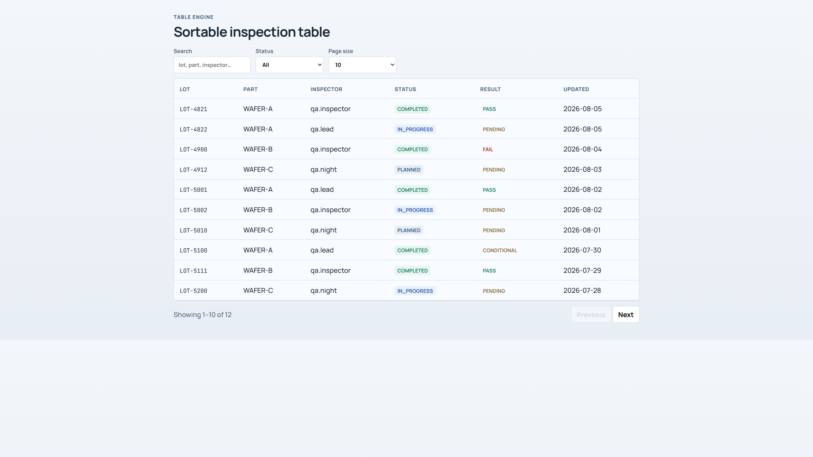

# table-engine

Client-side table engine with search, status/result filters, column sort, pagination, and clear-filters.

## Status

Complete: table helpers, sample data, accessible demo page, styles, unit tests, and CI.


## Screenshot



## Run

```powershell
python -m http.server 5181
```

Then open http://localhost:5181

## Module

```js
import { filterRows, sortRows, paginate } from "./js/engine.js";

const filtered = filterRows(rows, { query: "WAFER", status: "COMPLETED", result: "PASS" });
const sorted = sortRows(filtered, "updated", "desc");
const page = paginate(sorted, 1, 10);
```

Default page size is `10` (`paginate(rows, page, pageSize)`).

```bash
node --test test/engine.test.mjs
```

## License

MIT
